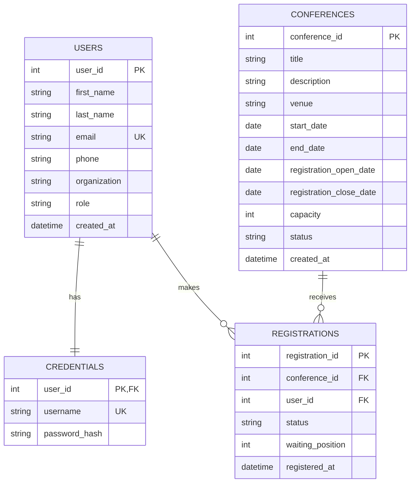

# Conference Management System ER Diagram

## Tables and relationships

- Each user has one credentials record. Credentials are stored separately from profile information.
- A user can register for many conferences, and a conference can have many registrations.
- Each registration belongs to one user and one conference.
- A user can only have one registration per conference.

## Constraints

- User email and credential username must be unique.
- User role must be `ADMIN` or `PARTICIPANT`.
- Conference capacity must be greater than zero.
- Conference and registration statuses are restricted to the values defined in `schema.sql`.
- Conference start date must not be after its end date. Registration open date must not be after its close date.
- A waitlisted registration must have a positive waiting-list position. Confirmed and cancelled registrations must not have a waiting-list position.
- Deleting a user or conference deletes their related credentials or registrations through the foreign-key cascade rules.
